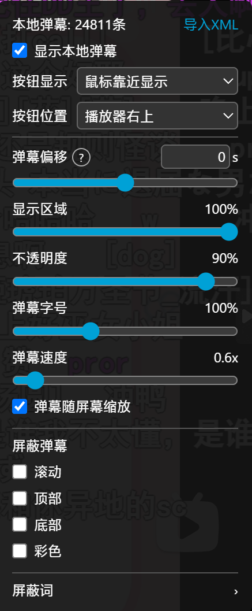

# B站本地弹幕 XML 注入

在哔哩哔哩视频播放器上加载本地弹幕 XML 文件，让弹幕随视频进度同步显示。适用于 B 站视频、番剧和视频列表页面。

 

## 安装

需要浏览器装有 [Tampermonkey](https://tampermonkey.net/) 或 [Violentmonkey](https://violentmonkey.github.io/) 插件。

安装好用户脚本管理器后，点击下面的链接安装脚本：

[安装本地弹幕脚本](https://github.com/NieR4ever/hinome_no_danmaku/raw/refs/heads/main/local-danmaku.user.js)

## 使用指南

1. 打开哔哩哔哩视频、番剧或视频列表页面。
2. 点击播放器上的本地弹幕按钮，打开设置面板。
3. 点击「导入 XML」，选择本地弹幕文件。支持 B 站格式和录播姬格式的弹幕 XML。
4. 开始播放视频，导入的弹幕会根据视频进度同步显示；拖动进度条时也会同步定位。

## 功能

- 调整弹幕显示区域、不透明度、字号和速度，也可选择弹幕是否随屏幕缩放。
- 调整弹幕时间偏移，正数延后显示，负数提前显示。
- 按类型屏蔽滚动、顶部、底部或彩色弹幕。
- 设置屏蔽词；每行一个词，不区分大小写，也支持 `/正则/` 格式。
- 将方括号中的 B 站表情代码替换为对应图片；方括号内以 `https://i0.hdslb.com/` 开头的图片地址也会直接显示。映射保存在独立的 `emoticons.json` 文件中，导入 XML 时从仓库加载。
- 自定义控制按钮的位置和显示方式。
- 自动记住设置，下次打开视频时继续使用。

### 维护表情映射

在 `emoticons.json` 中添加或修改 `{ "text": "表情文本", "url": "https://..." }` 条目即可，无需修改用户脚本。`text` 可带方括号或不带方括号，但弹幕中只有 `[表情文本]` 才会转换为图片；同名条目优先使用带方括号的映射。加载映射失败时会提示，并仍可解析图片地址。

 
